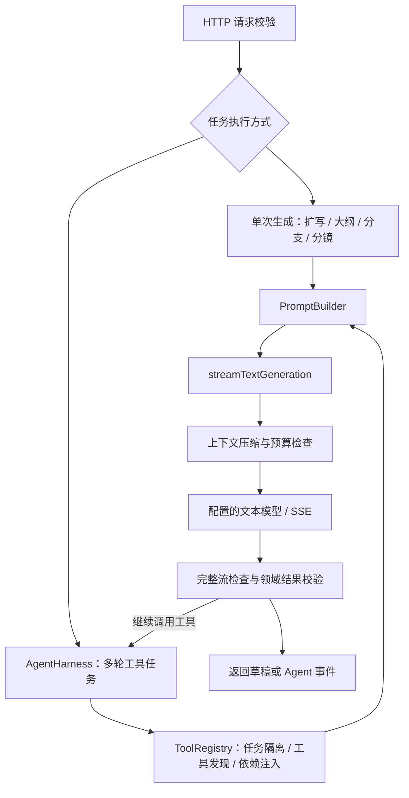

# AI Agent 架构

AI Agent 基于 AI SDK v4，面向影视创作任务，通过提示词构建、工具注册、上下文防护和执行循环组织模型调用。

## 执行路径

单次生成无需额外规划轮次。`generateStory`、`generateCreation` 和扩写接口共用提示词管道及底层文本传输。`AgentHarness` 管理需要工具的多轮任务，维护本次运行的历史、循环检测、用量、有限重试及取消信号。页面确认应用草稿后才修改画布。

## Prompt Pipeline

默认顺序为 `coreRules → toolGuide → deferredTools → projectContext → taskInstructions`。每个 pipe 接收同一份上下文，返回文字或 null；`sections()` 可检查生效片段，`build()` 使用相同片段拼装提示词。项目资料有字段白名单，并明确标为创作数据。

输出格式由任务决定：`expand-idea` 返回中文正文，故事、分支和分镜返回完整 JSON。无工具的任务不再要求调用 `generate_outline` 或 `validate_story`。提示词携带版本号；Agent 每一轮重新构建提示词，以反映工具发现后的能力变化。

## 工具注册

`ToolDefinition` 集中定义名称、说明、Zod 参数、执行函数、任务 profiles、并发策略和结果保留策略。`ToolDeps` 注入模型、项目资料、媒体 provider、取消信号和用量回调；工具不自行挑选另一套文本模型。

`buildRegistry(task)` 创建任务独立的 registry。工具可见性、延迟工具摘要、搜索结果和 token 估算均遵守当前 profile。`shouldDefer` 工具初始不发送完整定义；存在延迟工具时，registry 提供保留名称 `tool_search`，支持名称或关键词搜索，最多返回 5 个匹配项。发现后下一轮才开放调用。现有小型生产工具集仍默认直接开放，不为少量工具强加一次搜索轮次。

独立安全调用可并发，独占调用通过 registry 锁串行执行。一般结果按 head/tail 截断；完整故事及媒体结构化结果使用 `preserveResult`，避免截断 JSON 或素材地址。

## 上下文管理

所有文本模型请求都经过 `streamTextGeneration`：

1. 估算消息、系统提示词和实际 JSON Schema 工具定义的 token，保守考虑中文。
2. 在模型窗口的 75% 预算内预留输出空间（默认 8000 token，扩写 2500 token）。
3. 保留最近 3 条工具结果，清理更早结果；预算仍超限时按顺序清理剩余工具结果。
4. 保留工具调用 ID 与消息结构，以明确标记替换清理内容，禁止模型猜测缺失信息。
5. 将压缩后的消息实际发送给模型，并在 Agent 下一轮沿用；原始调用方消息不被修改。
6. 若仍超限，在请求模型前失败，要求缩小输入范围。

当前是请求内上下文管理，没有接入跨项目长期记忆、RAG、TTL 淘汰或模型生成的历史摘要。角色、风格、故事和分支由项目创作资料传入。后续若引入知识检索，可通过新增 pipe 注入资料摘要并注册检索工具；需另行定义项目隔离和持久化规则。

## 失败与验证

文本传输统一使用 SSE，完整结束后才接受结果。超时为 120 秒；底层 SDK 不自动重试。Harness 仅对可重试且尚未输出文本或执行工具的失败进行有限重试，避免重复付费生成。取消信号贯穿请求、模型和工具。

结构校验继续由领域生成函数负责。素材成功状态与 URL 取自实际工具结果，不接受模型虚构的完成状态。上下文清理、工具调用、进度与错误通过 Agent 事件返回。

测试覆盖：pipe 输出格式、工具 profile 隔离、发现后下一轮注入、压缩消息真实发送、工具定义及输出预算、完整流校验、取消、循环检测和避免重复付费调用。测试使用离线模型与模拟 SSE，不代表真实模型的创作质量或延迟。
